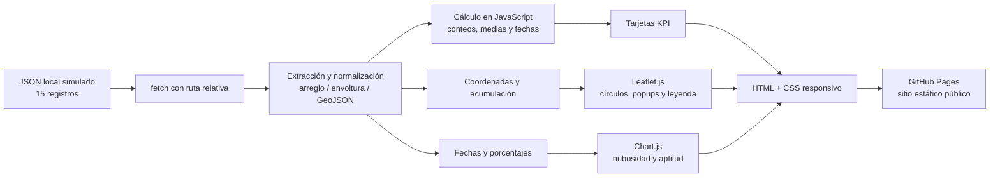

# Benchmarking de herramientas de BI y prototipado del dashboard PlasTrack con IA

**Autores:** Equipo PlasTrack (cuatro integrantes; completar nombres)  
**Institución:** [Completar]  
**Asignatura:** Inteligencia de Negocios, Unidad 1  
**Fecha:** [Completar]

## Resumen

Este trabajo compara Power BI, Looker Studio y una solución web de código abierto basada en Leaflet.js y Chart.js para seleccionar una alternativa de visualización para PlasTrack, un prototipo académico de monitoreo de pasadas satelitales simuladas sobre Galápagos. La evaluación considera visualización geoespacial, integración de JSON/CSV, licenciamiento, usabilidad, rendimiento web, publicación, responsividad, curva de aprendizaje, personalización y dependencia de conectores. Se propone una escala cualitativa de 1 a 5, con igual ponderación y basada en documentación pública y en el ajuste a los requisitos; no constituye una prueba comparativa de rendimiento en laboratorio. El prototipo elegido es una aplicación estática HTML, CSS y JavaScript, con Leaflet.js para el mapa y Chart.js para la serie temporal, publicada como sitio estático. Consume un archivo local de 15 registros sintéticos, calcula indicadores descriptivos y representa las pasadas con círculos graduados. El análisis del archivo arroja 44.8% de nubosidad media, 68.8% de aptitud media, 14 registros con acumulación positiva y seis con valor de acumulación igual o mayor que 3. Estos resultados describen únicamente la muestra ficticia y no son observaciones ambientales ni mediciones oficiales de Copernicus.

**Palabras clave:** Inteligencia de Negocios; Galápagos; visualización geoespacial; Leaflet.js; Chart.js; Copernicus; dashboard.

## 1. Introducción

La Inteligencia de Negocios (BI, por sus siglas en inglés) reúne prácticas y tecnologías para transformar datos en información útil para el análisis y la toma de decisiones [1, 2]. Un dashboard facilita la lectura de indicadores y relaciones al integrar métricas, series temporales y vistas espaciales en una interfaz común.

PlasTrack es un prototipo académico que simula la exploración de pasadas satelitales sobre las islas Galápagos. La observación satelital puede apoyar el monitoreo ambiental al ofrecer coberturas repetidas y variables espaciales; sin embargo, para extraer conclusiones ambientales se requieren productos satelitales auténticos, métodos de procesamiento documentados, control de calidad y validación de campo. El prototipo de esta actividad no realiza ese análisis: utiliza registros sintéticos para probar una arquitectura de BI y la interacción entre datos, indicadores, mapa y gráfico.

El objetivo de este reporte es comparar herramientas comerciales de BI con una alternativa web de visualización, justificar la selección para el escenario concreto de PlasTrack y documentar una arquitectura, los KPIs, la generación asistida por IA y las verificaciones pendientes. La comparación es una evaluación de adecuación funcional y operativa; no mide de manera experimental tiempos de carga, precisión cartográfica ni costos contractuales.

## 2. Metodología

### 2.1 Alcance y criterios

Se contrastan tres alternativas: Microsoft Power BI, Looker Studio y una aplicación web estática con Leaflet.js y Chart.js. Los criterios se derivan de los requisitos de la actividad:

1. Mapas, capas geoespaciales y mapas de calor.
2. Integración de datos JSON/CSV semejantes a los de Copernicus.
3. Licenciamiento y costos de entrada/publicación.
4. Usabilidad para preparar y consultar dashboards.
5. Rendimiento esperado en navegador y escalabilidad.
6. Facilidad de publicación pública.
7. Responsividad en computador y móvil.
8. Curva de aprendizaje.
9. Personalización visual y funcional.
10. Dependencia de conectores, servicios externos y configuración de terceros.

### 2.2 Escala de valoración

Se usa una escala ordinal de 1 a 5: **1**, ajuste muy bajo; **2**, bajo; **3**, intermedio o condicionado; **4**, alto; **5**, muy alto para los requisitos del prototipo. Para “curva de aprendizaje”, la puntuación representa facilidad de aprendizaje: 5 es más fácil. Para “dependencia de conectores”, 5 indica menor dependencia de conectores de datos propietarios o especializados. Las puntuaciones son una estimación razonada del equipo y deben validarse con la versión, región, configuración institucional y plan vigentes. Se asigna el mismo peso a cada criterio y se calcula una media simple; no es una calificación universal de los productos.

La dimensión de rendimiento se califica por adecuación arquitectónica esperada, no por una prueba cronometrada. No se midieron latencia, consumo de memoria, rendimiento en distintos dispositivos ni límites a gran escala. Una comparación experimental requeriría fijar datos, navegador, red, dispositivos, filtros, tamaño de carga y protocolo de medición comunes.

### 2.3 Dataset y uso de IA generativa

El archivo `data_copernicus_sample.json` contiene 15 registros simulados entre el 5 de enero y el 12 de abril de 2024, distribuidos entre Isabela, Santa Cruz, San Cristóbal, Fernandina, Floreana y Santiago. Incluye fecha y hora UTC, coordenadas, isla, zona, porcentaje de nubosidad, aptitud del sensor, satélite y un valor entero de acumulación de 0 a 4. Fue generado con apoyo de IA generativa a partir de una instrucción estructurada que especificó el esquema, el periodo, la frecuencia aproximada, las islas y zonas, los rangos de valores y la relación inversa esperada entre nubosidad y aptitud.

La muestra es ficticia, con fines académicos; no son mediciones oficiales de Copernicus, no fue descargada de Copernicus Data Space Ecosystem y no debe usarse para inferir contaminación, condiciones reales de nubes, calidad instrumental ni tendencias ecológicas. Los valores `nubosidad_pct`, `aptitud_sensor_pct` y `acumulacion_zonas` son campos simulados. La etiqueta de acumulación no representa una concentración física ni una zona crítica validada.

### 2.4 Cálculo y resultados descriptivos de la muestra

Los valores siguientes se calcularon directamente desde las 15 filas del JSON. Las medias se muestran redondeadas a una cifra decimal. Todos los registros de la muestra tienen valores numéricos para ambos campos porcentuales; si se incorporaran faltantes, la implementación calcula la media sobre los valores numéricos disponibles.

| Resultado descriptivo | Valor calculado | Alcance |
|---|---:|---|
| Registros/pasadas | 15 | Conteo de filas de la muestra |
| Nubosidad media | 44.8% | Media aritmética de `nubosidad_pct` |
| Aptitud media | 68.8% | Media aritmética de `aptitud_sensor_pct` |
| Registros con acumulación positiva | 14 | `acumulacion_zonas > 0` |
| Registros con nivel alto propuesto | 6 | `acumulacion_zonas >= 3`; umbral didáctico, no validado |
| Periodo | 2024-01-05 a 2024-04-12 | Mínimo y máximo de `fecha` |
| Islas representadas | 6 | Conteo de islas distintas |

## 3. Benchmarking comparativo

La puntuación resume el ajuste para este proyecto concreto. Cada celda combina la nota con una ventaja y una condición o limitación relevante. Las funciones dependen de la edición y configuración de cada producto; antes de entregar, deben revisarse en documentación oficial.

| Criterio | Power BI | Looker Studio | JS Web: Leaflet.js + Chart.js |
|---|---|---|---|
| Mapas y heatmaps | **4/5.** Visuales geográficos y Azure Maps ofrecen capas, incluida representación tipo heat map. **Límite:** disponibilidad, políticas del administrador, configuración y visual utilizado condicionan el uso. | **4/5.** Visualizaciones de Google Maps/Geo incluyen representaciones geográficas, con opciones que dependen del tipo de gráfico y del dato geográfico. **Límite:** menor control de bajo nivel que una API cartográfica programable. | **5/5.** Leaflet permite marcadores, círculos, capas y plugins de calor. **Límite:** el heatmap requiere una capa/plugin adicional; el prototipo actual usa círculos graduados, no un heatmap. Chart.js no es una librería geográfica. |
| Integración JSON/CSV de Copernicus | **4/5.** Power Query permite importar y transformar JSON/CSV. **Límite:** actualización de fuentes locales en el servicio puede requerir gateway y configuración de credenciales. | **2/5.** Puede conectarse mediante fuentes como Sheets, BigQuery y conectores disponibles. **Límite:** no equivale a hacer `fetch()` de cualquier JSON local; puede necesitar transformación, carga intermedia o conector de terceros. | **5/5.** JavaScript puede leer JSON/CSV publicado junto al sitio y normalizarlo directamente. **Límite:** la validación, transformación y gestión de errores quedan a cargo del equipo. |
| Licenciamiento y costos | **3/5.** Power BI Desktop permite autoría sin costo de licencia en escenarios habituales. **Límite:** compartir y colaborar suele estar sujeto a licencias/capacidad; condiciones y precios varían. | **4/5.** La edición estándar de Looker Studio se ofrece sin costo de uso en escenarios habituales. **Límite:** Pro, conectores, fuentes y servicios subyacentes pueden tener costos o condiciones; verificar oferta vigente. | **5/5.** Leaflet y Chart.js son proyectos de código abierto y el alojamiento estático puede no tener costo para un proyecto público elegible. **Límite:** CDN, teselas, tráfico y términos de servicios externos deben considerarse; “sin costo” no significa infraestructura ilimitada. |
| Usabilidad | **4/5.** Interfaz visual, modelado y ecosistema integrados para analistas. **Límite:** modelado, DAX y administración añaden complejidad. | **4/5.** Creación de informes visual y rápida para usuarios de fuentes conectadas. **Límite:** combinar fuentes o depurar conectores puede complicarse. | **2/5.** Interfaz de consumo diseñada a medida y sin entorno de autoría adicional para el usuario final. **Límite:** construir y mantenerla requiere programar HTML, CSS y JavaScript. |
| Rendimiento web | **3/5.** Motor y servicio gestionan modelos y consultas; puede servir a reportes amplios. **Límite:** rendimiento depende de modelo, consulta, capacidad y red; no se midió en esta actividad. | **3/5.** Servicio gestionado evita operar un servidor propio. **Límite:** consultas, fuentes externas, conectores y red influyen en carga; no se midió aquí. | **4/5.** Para 15 registros, procesar los datos en el cliente es una arquitectura ligera. **Límite:** los datos, bibliotecas y teselas requieren red; conjuntos grandes pueden exigir agregación, optimización o backend. Nota: la nota no procede de una prueba de velocidad. |
| Despliegue público | **2/5.** Puede compartirse mediante opciones de Power BI y existe “Publish to web” en escenarios permitidos. **Límite:** no se publica como sitio estático en GitHub Pages y la publicación web expone el informe públicamente; no usar con datos sensibles. | **4/5.** Permite compartir o embeber informes alojados en Google. **Límite:** sigue dependiendo de la plataforma, permisos y configuración de publicación; no es un despliegue autónomo en GitHub Pages. | **5/5.** HTML, CSS, JS y JSON estáticos pueden publicarse directamente en GitHub Pages. **Límite:** hay que mantener el repositorio, las rutas relativas y dependencias externas. |
| Responsividad | **4/5.** Hay opciones de diseño móvil y aplicaciones de visualización. **Límite:** la experiencia depende del diseño del informe y del modo de acceso. | **4/5.** Los informes pueden visualizarse en web y embeberse. **Límite:** el ajuste final del contenedor y los componentes debe probarse en dispositivos. | **4/5.** La interfaz se controla con CSS Grid/Flexbox y media queries. **Límite:** la responsividad del código debe verificarse en dispositivos reales; no se reporta aquí una matriz completa de pruebas. |
| Curva de aprendizaje (facilidad) | **3/5.** Herramientas visuales accesibles para empezar. **Límite:** Power Query, DAX, modelo semántico y publicación requieren aprendizaje. | **4/5.** Curva inicial moderada para construir reportes básicos. **Límite:** fuentes, permisos, campos geográficos y conectores elevan la dificultad. | **2/5.** Leaflet y Chart.js simplifican la representación una vez que existe código. **Límite:** se necesitan fundamentos de JavaScript, DOM, CSS, depuración y HTTP. |
| Personalización | **4/5.** Medidas, temas y visuales permiten adaptar informes. **Límite:** ciertas extensiones dependen de visuales externos, políticas y compatibilidad. | **3/5.** Ofrece controles de diseño, campos calculados y visualizaciones disponibles. **Límite:** la interacción y el renderizado están delimitados por la plataforma. | **5/5.** El equipo controla estructura, estilo, eventos, escala y comportamiento. **Límite:** cada función personalizada aumenta el trabajo de desarrollo y mantenimiento. |
| Dependencia de conectores | **3/5.** Dispone de conectores y opciones de importación nativos. **Límite:** actualización y acceso a determinadas fuentes puede requerir gateway, configuración o conectores específicos. | **2/5.** La conexión a fuentes es central al producto. **Límite:** algunas fuentes requieren conectores de socios/comunidad o servicios intermedios. | **4/5.** El JSON estático se consume directamente y no requiere conector de BI. **Límite:** la app todavía depende de CDN para bibliotecas y de un proveedor de teselas para el mapa base. |
| **Suma / media simple** | **34/50 · 3.4/5** | **34/50 · 3.4/5** | **41/50 · 4.1/5** |

La suma no demuestra superioridad general. Refleja prioridades del enunciado: datos locales, visualización web, personalización y GitHub Pages. Si el proyecto privilegiara gobierno corporativo, modelos compartidos, seguridad centralizada y actualización desde fuentes empresariales, la ponderación y la alternativa podrían cambiar.

## 4. Alternativa seleccionada y justificación

Se selecciona la solución web estática con Leaflet.js y Chart.js por su ajuste directo al entregable: el JSON permanece en el repositorio, JavaScript lo carga con ruta relativa, los indicadores se calculan en el navegador y GitHub Pages puede servir los archivos sin backend ni proceso de compilación. Leaflet permite ubicar cada registro y asociar popups a círculos cuyo tamaño y color codifican el valor ordinal de `acumulacion_zonas`; Chart.js representa la serie de nubosidad y aptitud por fecha. HTML/CSS permiten controlar una presentación adaptativa y la experiencia visual.

La selección también facilita inspeccionar el flujo de BI y relacionar el esquema de datos con cada visualización. El prototipo mantiene una arquitectura pequeña, apropiada para 15 observaciones ficticias y para demostrar integración, transformación básica y presentación.

La elección tiene limitaciones. A diferencia de una plataforma BI, la aplicación no ofrece de forma automática control de acceso, gobierno de datos, modelado semántico, permisos por usuario, actualización programada, auditoría, filtros analíticos avanzados ni conectores empresariales. El código y el despliegue quedan bajo responsabilidad del equipo. La aplicación carga sus dependencias JavaScript y el mapa base desde servicios externos, por lo que su disponibilidad depende de conexión y políticas de esos proveedores. OpenStreetMap requiere respetar la atribución y la política de uso de sus teselas; el servidor público de teselas no debe suponerse un servicio gratuito de uso ilimitado [11].

Además, los círculos graduados son una codificación visual de un campo simulado, no una medición de contaminación ni un mapa de calor espacial. Para uso científico sería necesario establecer la definición del indicador, su fuente, resolución, unidades, incertidumbre, validación y método espacial; si se requiere densidad espacial, podría añadirse un plugin de heatmap y documentarse su algoritmo, sin confundir densidad de puntos con concentración ambiental.

## 5. Arquitectura de BI propuesta

El flujo separa la fuente, la preparación de registros, las métricas y la capa de presentación. En este prototipo la preparación ocurre en el cliente y no hay base de datos ni backend. `app.js` extrae registros de estructuras comunes y normaliza campos, incluidas propiedades GeoJSON; los valores numéricos faltantes se tratan como no disponibles en promedios y visualizaciones.

**Capas lógicas:**

- **Fuente:** archivo `data_copernicus_sample.json` versionado junto a la aplicación. En una etapa posterior, podría reemplazarse por exportaciones verificables de Copernicus Data Space Ecosystem respetando condiciones de uso y metadatos.
- **Preparación:** extracción de arreglos anidados comunes, normalización de campos y lectura de coordenadas. El dataset actual es un arreglo plano y se consume sin modificación.
- **Métricas:** funciones de JavaScript para promedios, conteos y periodo mínimo/máximo.
- **Presentación:** tarjetas HTML, mapa Leaflet y línea temporal Chart.js. Círculos y color representan categorías del valor simulado de acumulación.
- **Publicación:** GitHub Pages entrega archivos estáticos. No se almacenan credenciales ni se usa una API key en el prototipo.

## 6. Ficha de KPIs

| KPI | Definición y fórmula | Unidad | Campo(s) | Interpretación / meta o referencia |
|---|---|---|---|---|
| Total de pasadas | Número de registros válidos: `COUNT(registros)` | Pasadas | `id` (conteo de filas) | La muestra contiene **15**. No tiene meta ambiental; sirve para describir la cobertura del archivo. |
| Nubosidad promedio | `SUM(nubosidad_pct numérico) / COUNT(nubosidad_pct numérico)` | % | `nubosidad_pct` | **44.8%** en esta muestra. Un valor menor suele favorecer observaciones ópticas, pero la interpretación depende del producto, zona, fecha y criterio de calidad. No se define umbral universal en este trabajo. |
| Aptitud promedio del sensor | `SUM(aptitud_sensor_pct numérico) / COUNT(aptitud_sensor_pct numérico)` | % | `aptitud_sensor_pct` | **68.8%** en la muestra. Es un indicador simulado; su significado operativo y umbral de aceptación deben definirse antes de usar datos reales. |
| Registros con acumulación positiva | `COUNT(acumulacion_zonas > 0)` | Registros | `acumulacion_zonas` | **14** registros. Es el KPI que muestra la tarjeta actual. Cuenta registros, no zonas geográficas distintas ni una concentración física. No equivale por sí mismo a criticidad. |
| Registros de nivel alto (propuesta) | `COUNT(acumulacion_zonas >= 3)` | Registros | `acumulacion_zonas` | **6** registros con un umbral de demostración. La categoría se propone para el ejercicio y no está validada por una metodología ambiental. No es el valor de la tarjeta actual, que cuenta todo valor mayor que cero. |
| Periodo analizado | `MIN(fecha)` a `MAX(fecha)` | Fecha | `fecha` | **2024-01-05 a 2024-04-12**. Delimita las filas disponibles, no necesariamente el periodo de observación de una misión real. |

Los promedios ignoran campos no numéricos o ausentes. Para registros duplicados, fechas inválidas o mediciones con diferente cobertura espacial sería necesario definir reglas adicionales. En particular, el KPI de acumulación debe nombrarse “registros con acumulación” y no “número de zonas críticas” mientras no se defina cómo agrupar zonas y validar el umbral.

## 7. Bitácora de prompts de IA

La IA generativa se utilizó como apoyo para estructurar el dataset, generar el prototipo y redactar documentación. La bitácora siguiente resume la interacción disponible; no sustituye guardar el texto íntegro, fecha, herramienta y evidencia que exija el docente. Debe completarse con las transcripciones reales del equipo y no atribuir a la IA verificaciones que fueron realizadas por personas o por pruebas separadas.

**Prompt 0: generación del dataset (síntesis de la instrucción utilizada).** Se pidió actuar como científico de datos de teledetección y producir `data_copernicus_sample.json` válido con exactamente 15 pasadas simuladas, fechas semanales aproximadas de enero a abril de 2024, coordenadas plausibles de Galápagos, seis islas y zonas coherentes, valores de nubosidad de 5 a 85, aptitud de 30 a 98 inversamente relacionada, alternancia de Sentinel-2A, Sentinel-2B y Landsat-9, acumulación entera de 0 a 4 y campos uniformes. También se solicitó un resumen tabular y una nota que aclarara el carácter académico y no oficial de los datos.

| ID | Solicitud a IA / propósito | Salida o artefactos | Revisión humana y evidencia que debe conservarse |
|---|---|---|---|
| Prompt 0 — dataset | Generar datos sintéticos con el esquema obligatorio, rangos, periodo, islas y restricciones de JSON. | `data_copernicus_sample.json`. | Se validó que hay 15 filas, fechas ordenadas, campos consistentes y rangos solicitados. Conservar prompt íntegro y resultado de validación. Confirmar que no se presenten como datos oficiales. |
| Prompt 1 — dashboard | Solicitar una aplicación estática responsiva en HTML/CSS/JavaScript, `fetch()` relativo, KPIs, Leaflet, Chart.js, manejo de errores, README y publicación en GitHub Pages. | `index.html`, `styles.css`, `app.js` y documentación de ejecución/despliegue. | Revisar el comportamiento en móvil y escritorio, carga de CDN y teselas, textos, accesibilidad, rutas y URL pública. Guardar la instrucción original y evidencia del despliegue real. |
| Prompt 2 — reporte | Solicitar un paper técnico en español que compare Power BI, Looker Studio y JS Web, documente la arquitectura, KPIs, prompts y referencias sin inventar precios ni resultados. | `reporte_tecnico.md`. | Comprobar citas, escala, puntuaciones con el equipo y formato institucional; completar autores, institución y fecha. Guardar la instrucción íntegra. |
| Prompt 3 — QA y despliegue | **Plantilla para completar si se utilizó:** pedir a la IA revisar rutas, consola, datos, KPIs, mapa/gráfico, visualización en móvil y pasos de GitHub Pages. | Registrar aquí los cambios o pruebas realmente generados a partir de ese prompt. | No afirmar que este prompt se ejecutó si no hay transcripción. En esta sesión se verificó sintaxis de JavaScript, lógica con un harness de prueba y respuestas HTTP locales; conservar los comandos/salidas si se usarán como evidencia. |

En esta interacción el asistente fue GitHub Copilot; registrar el modelo/versionado mostrado en la interfaz si la rúbrica lo solicita. Las puntuaciones del benchmark y las recomendaciones requieren revisión del equipo: la salida de IA no constituye una validación de precios, licencias, comportamiento cartográfico ni resultados científicos.

## 8. Conclusiones y recomendaciones

1. Para el objetivo específico de publicar un prototipo pequeño, autónomo y público en GitHub Pages, Leaflet.js y Chart.js ofrecen el mayor ajuste estimado: permiten consumir el JSON directamente, personalizar la interfaz y evitar un backend. La puntuación de 4.1/5 es una valoración cualitativa de adecuación, no un benchmark universal.
2. Power BI y Looker Studio son alternativas más apropiadas cuando se priorizan autoría analítica empresarial, gobierno, conectores gestionados, colaboración y administración central. La integración con JSON local y la forma de publicar públicamente deben revisarse con la configuración vigente.
3. La muestra produjo promedios sintéticos de 44.8% de nubosidad y 68.8% de aptitud; 14 registros tienen acumulación positiva y seis alcanzan el umbral demostrativo `>= 3`. Estos valores describen únicamente los datos generados y no soportan conclusiones ambientales sobre Galápagos.
4. El mapa implementado utiliza círculos graduados, no una capa de heatmap. La leyenda y el reporte deben evitar presentar el campo `acumulacion_zonas` como contaminación medida o zona crítica observada. Para una versión científica se necesitarían datos oficiales trazables, metadatos, criterios espaciales y validación independiente.
5. Antes de entregar, se recomienda ejecutar pruebas manuales en la URL publicada, en anchuras de escritorio y móvil; revisar consola y carga de datos; verificar precios, licencias, conectores y políticas de teselas en fuentes oficiales; conservar evidencia de prompts; y sustituir autores genéricos por los nombres del equipo.

## Referencias

[1] Sharda, R., Delen, D. y Turban, E. *Business Intelligence, Analytics, and Data Science: A Managerial Perspective*. 4.ª ed. Pearson, 2018.

[2] Davenport, T. H. y Harris, J. G. *Competing on Analytics: The New Science of Winning*. Harvard Business School Press, 2007.

[3] Microsoft Learn. Documentación de Power BI, Power Query y visual de Azure Maps. Consultar documentación oficial de Power BI: <https://learn.microsoft.com/power-bi/>. Las capacidades y políticas aplicables deben verificarse para la cuenta/tenant utilizados.

[4] Microsoft. Información de planes y precios de Power BI: <https://www.microsoft.com/power-platform/products/power-bi/pricing>. Verificar condiciones, moneda y disponibilidad vigentes; este reporte no fija precios.

[5] Google Cloud. Documentación de Looker Studio: <https://cloud.google.com/looker/docs/studio>. Consultar las páginas oficiales sobre fuentes de datos, conectores y gráficos de Google Maps.

[6] Google Cloud. Información de Looker Studio y sus opciones de producto en la documentación oficial. Confirmar por separado el alcance de la edición estándar, Pro, conectores y costos vigentes; no se consignan precios en este reporte.

[7] Leaflet. Documentación y referencia de API: <https://leafletjs.com/reference.html>. Revisar también la licencia del proyecto y la licencia de los plugins adicionales que se incorporen.

[8] Chart.js. Documentación oficial: <https://www.chartjs.org/docs/latest/>.

[9] Copernicus Data Space Ecosystem. Portal oficial de acceso a datos: <https://dataspace.copernicus.eu/>. El dataset de este prototipo no fue obtenido de este portal.

[10] GitHub Docs. Documentación de GitHub Pages: <https://docs.github.com/pages>. Verificar elegibilidad del repositorio, configuración de publicación y límites vigentes.

[11] OpenStreetMap Foundation. Política de uso del servicio de teselas estándar: <https://operations.osmfoundation.org/policies/tiles/>. Consultar atribución, requisitos técnicos y condiciones antes de usar el servicio en producción.
